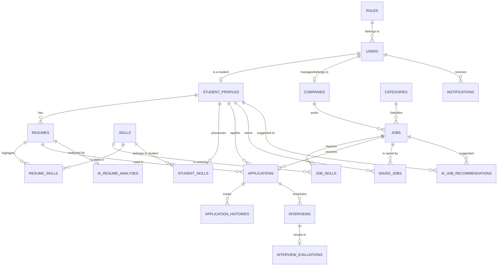

# JobMate Entity Relationship Diagram (ERD)

Mô tả quan hệ giữa các thực thể trong hệ thống JobMate.

## Giải thích quan hệ chính:
1.  **Users & Roles**: Phân quyền hệ thống (Admin, Recruiter, Candidate).
2.  **StudentProfiles & Companies**: Thông tin chi tiết mở rộng cho User tùy theo Role.
3.  **Jobs & Skills**: Một công việc yêu cầu nhiều kỹ năng (n-n qua JobSkills).
4.  **Resumes**: Ứng viên (Student) có thể có nhiều bản CV.
5.  **Applications**: Trung tâm của quy trình, kết nối Candidate, Job và Resume.
6.  **ApplicationHistories**: Lưu lại mọi bước chuyển trạng thái (Submitted -> Reviewing -> ...).
7.  **AI Components**: Hỗ trợ phân tích CV và gợi ý việc làm dựa trên profile ứng viên.
